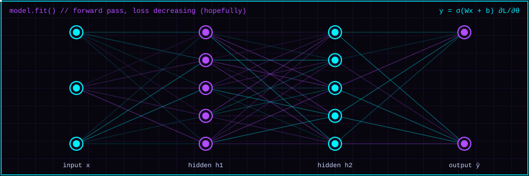
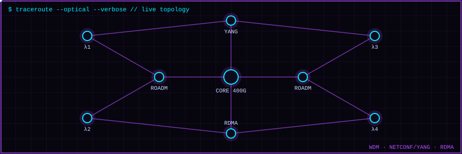
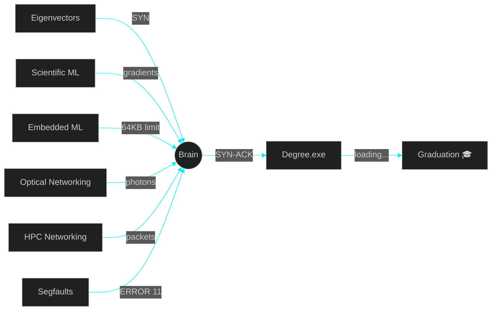

<div align="center">




</div>

---

### 💾 `SYSTEM_INFO`

```text
┌──────────────────────────────────────────────────────────┐
│  USER      : Gaitsiwe Mathai  (gaitsiwemathai)           │
│  STATUS    : Undergraduate.exe — still compiling...      │
│  RUNTIME   : between eigenvectors, network packets,      │
│              and segmentation faults                     │
│  MODULES   : Scientific ML | Embedded ML                 │
│              Network Automation & Programmability        │
│              Optical Networking | HPC Networking         │
│  FUEL      : coffee, spite, Stack Overflow               │
│  OPEN_TO   : collaboration [TRUE]                        │
└──────────────────────────────────────────────────────────┘
```

---

### 🧠 `neural_core.sys`

<div align="center">

</div>

**Scientific ML** · physics-informed networks, differentiable simulation, surrogate models

$$\mathcal{L}(\theta) = \underbrace{\lVert u_\theta - u_{\text{data}} \rVert^2}_{\text{data}} + \underbrace{\lVert \mathcal{N}[u_\theta] \rVert^2}_{\text{physics residual}}$$

**Embedded ML** · quantization, pruning and inference on microcontrollers with kilobytes of RAM

$$W_q = \operatorname{round}\!\left(\tfrac{W}{s}\right) + z \quad\Rightarrow\quad \text{32 bits} \to \text{8 bits}$$

🔍 Currently building: **Lightweight physics - informed neural networks for embedded systems**

---

### 🌐 `network_topology.sys`

<div align="center">

</div>

**Network Automation & Programmability** · configs, monitoring and deployments as code (APIs, NETCONF/YANG)
**Optical Networking** · fibre links, WDM, and moving bits as photons
**High Performance Networking** · low latency, high throughput, packet-level analysis

$$C = B \log_2\!\left(1 + \tfrac{S}{N}\right) \qquad \text{(Shannon: the speed limit of every link)}$$

🔍 Currently building: **Automated network performance monitoring and optimization for high spped optical networks**

---

### 🧮 `me.py`

```python
import numpy as np

class Gaitsiwe:
    status = "Undergraduate.exe (still compiling...)"

    def __init__(self):
        # life as a matrix
        self.life = np.array([[1, 0],    # sleep
                              [0, 1]])   # deadlines
        # det = 1 on a good day, 0 in exam week (singular)

    def scientific_ml(self, physics):
        return "teach a neural net the PDE, then argue about the boundary conditions"

    def embedded_ml(self, model):
        return model.quantize().prune().squeeze_into(kilobytes=64)

    def automate(self, network):
        return "why configure one router by hand when you can break fifty with a script"

    def debug(self, bug):
        return "printf('here');"   # no gdb was harmed
```

---

### ⚡ `toolchain.cfg`


---

### 🧭 `brain_topology.mmd`



---

### 📊 `telemetry.log`

<div align="center">


</div>

```diff
+ models squeezed onto microcontrollers: several
+ routers automated instead of hand-configured: yes
+ photons routed: countless
- segfaults avoided: 0 (they find me)
- RAM available on the MCU: what RAM
```

---

<div align="center">

```text
> exit 0   // thanks for visiting. go touch some grass, then come back.
```


</div>
