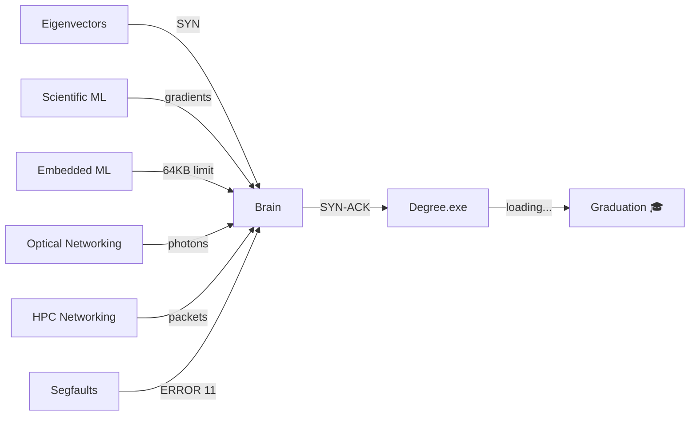

<div align="center">


# Hi, I'm Gaitsiwe Mathai 👋
### Scientific ML • Embedded ML • Network Automation • Optical & High-Performance Networking

</div>

```text
$ ping gaitsiwemathai
PING gaitsiwemathai (undergrad.local): 56 data bytes
64 bytes from brain: icmp_seq=0 ttl=64 time=coffee ms
64 bytes from brain: icmp_seq=1 ttl=64 time=coffee ms

--- gaitsiwemathai ping statistics ---
2 packets transmitted, 2 received, 0% packet loss
(packet loss: only in my sleep schedule)
```

### 🧮 `me.py`

```python
import numpy as np

class Gaitsiwe:
    status = "Undergraduate.exe (still compiling...)"
    focus  = {
        "machine_learning": ["Scientific ML", "Embedded ML"],
        "networking": ["Network Automation & Programmability",
                       "Optical Networking",
                       "High Performance Networking"],
    }
    fuel = ["coffee", "spite", "Stack Overflow"]

    def __init__(self):
        # My life as a matrix
        self.life = np.array([[1, 0],    # sleep
                              [0, 1]])   # deadlines
        # det(life) = 1 on a good day, 0 during exam week (singular)

    def scientific_ml(self, physics):
        return "teach a neural net the PDE, then argue with it about the boundary conditions"

    def embedded_ml(self, model):
        return model.quantize().prune().squeeze_into(kilobytes=64)

    def automate(self, network):
        return "why configure one router by hand when you can break fifty with a script"

    def debug(self, bug):
        return "printf('here');"       # no gdb was harmed

    def is_open_to_collab(self):
        return True   # DM me, I don't bite (unlike memory errors)
```

### 🧪 Machine Learning

**Scientific ML**
- 🔬 Physics-informed neural networks, differentiable simulation and surrogate models
- 📈 Linear algebra and numerical methods under the hood
- 🔍 Currently exploring: **[your scientific ML project]**


**Embedded ML (TinyML)**
- 🔌 Model compression: quantization, pruning, distillation
- 📟 Inference on microcontrollers and edge devices
- 🔍 Currently exploring: **[your embedded ML project]**


### 🌐 Networking

**Network Automation & Programmability**
- 🤖 Automating configs, monitoring and deployments with code
- 🔧 APIs, NETCONF/YANG, infrastructure as code


**Optical Networking**
- 💡 Fibre links, WDM and the physics of moving bits as photons

**High Performance Networking**
- ⚡ Low-latency, high-throughput data movement
- 🔬 Packet analysis: reading the wire one frame at a time


### 💻 Languages


### 🧭 Network Topology of My Brain



### 📊 Telemetry

<div align="center">


</div>

```diff
+ models squeezed onto microcontrollers: several
+ routers automated instead of hand-configured: yes
+ photons routed: countless
- segfaults avoided: 0 (they find me)
- RAM available on the MCU: what RAM
```

> *"It's not a bug, it's an unhandled exception in my understanding."*

<div align="center">


</div>
